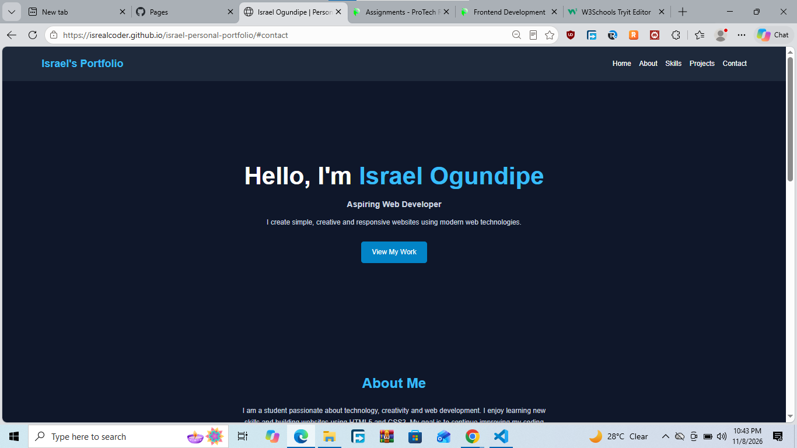

# israel-personal-portfolio

# Israel Ogundipe - Personal Portfolio

## About the Project

This is my personal portfolio website created as part of my Weeks 1-3 web development assignment at ProTech Rise Academy.

The website introduces me, showcases my skills and projects, and provides a contact form.

## Features

- Responsive personal landing page
- Semantic HTML5 structure
- Custom CSS3 styling
- Flexbox navigation and skills section
- CSS Grid project showcase
- Responsive design using media queries
- Accessible contact form

## Technologies Used

- HTML5
- CSS3
- Flexbox
- CSS Grid
- Git
- GitHub

## Website Sections

1. Home
2. About Me
3. Skills
4. Projects
5. Contact Me

## How to View the Project

1. Download or clone this repository.
2. Open the project folder.
3. Open `index.html` in your web browser.
## Website Screenshot

## Author

Israel Ogundipe

Aspiring Web Developer

